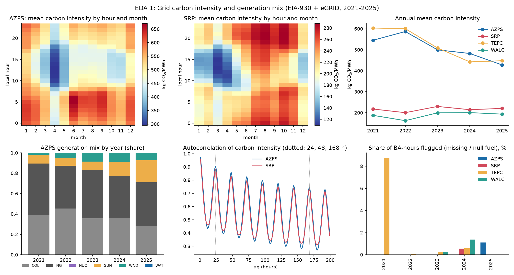
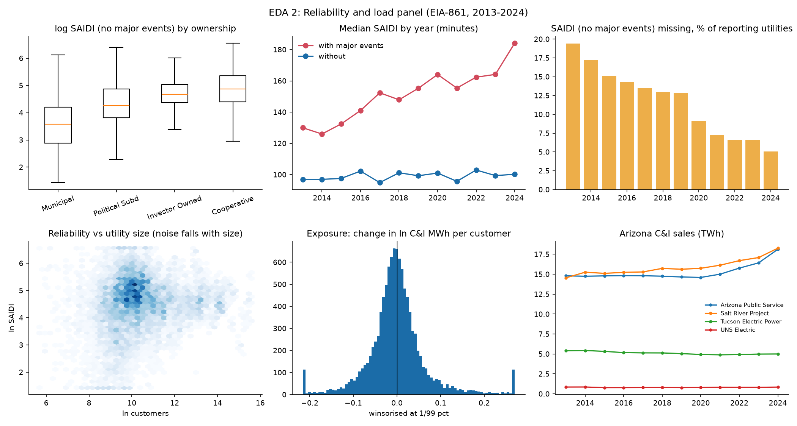
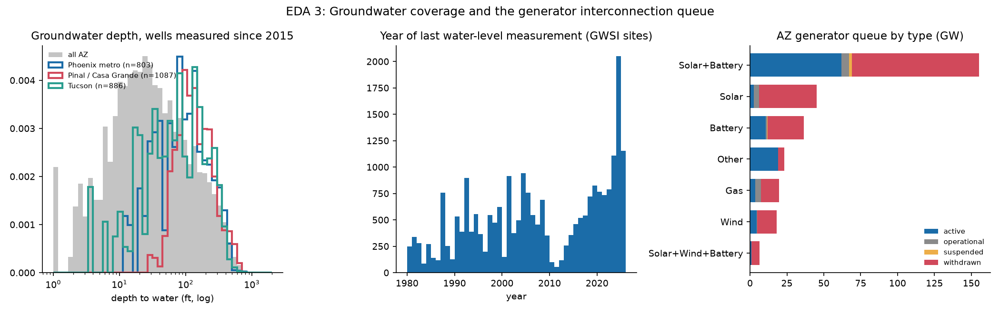

# Exploratory data analysis

Generated by `src/eda.py` from the unified tables built by `src/build_master.py`. Raw statistics are in
`results/eda_stats.txt`. Each section ends with what the finding means for modelling.

## Unified tables
| Table | Grain | Rows | Notes |
|---|---|---|---|
| `master_ba_hour.parquet` | balancing authority x hour (UTC) | 175,208 | generation by fuel, carbon intensity, demand, EIA day-ahead demand forecast, weather, quality flags; 28 columns |
| `master_utility_year.parquet` | utility-state x year | 11,845 | cleaned reliability panel plus BA code and BA-year carbon, demand and wet-bulb context (2021-2024 only, 53 of 136 Arizona rows) |
| `sites_scored.parquet` | 0.25-degree cell | 192 | water, heat, solar, queue features and suitability score |

Keys: BA code + UTC timestamp; utility number + state + year. AZPS and SRP have complete hourly coverage;
TEPC is missing 48 hours and WALC 40. Completeness: carbon intensity 99.4%, demand 99.4%, EIA demand forecast
97.2%, wet-bulb 100%.

## 1. Grid carbon intensity (EIA-930 + eGRID, 2021-2025)

**Observations**
- **Strong daily and seasonal structure.** Carbon intensity is lowest at midday in spring (March-April, when
  solar is high and demand is low) and highest on summer nights and mornings. The mean daily swing (max minus
  min hourly mean) is 158 kg/MWh for AZPS, 116 for TEPC, and about 70 for SRP and WALC.
- **A structural downward trend in two BAs.** From 2021 to 2025 mean intensity fell 22% in AZPS (546 to 428)
  and 26% in TEPC (604 to 448), while SRP (about 220) and WALC (about 190) stayed flat. In AZPS, solar's share
  of generation rose from 8.6% to 21.3% and coal's fell from about 39% to 28%.
- **Highly repeatable.** Autocorrelation is 0.95-0.98 at 1 hour, 0.85-0.91 at 24 hours and 0.67-0.75 at one
  week, with clear 24-hour peaks.
- **Data quality is good but uneven.** 0.1-0.3% of BA-hours are flagged for AZPS, SRP and WALC; TEPC has 1.9%,
  concentrated in 2021 (about 8.8% of that year's hours). Solar generation is negative in 4.5% of hours
  (night-time auxiliary load).
- **EIA's day-ahead demand forecast is good**: median absolute error 2.2% (SRP), 3.3% (AZPS), 4.6% (TEPC)
  and 7.1% (WALC). Wet-bulb temperature correlates 0.57-0.66 with demand in the three larger BAs but 0.20 in WALC.

**Implications**
- The 24-hour autocorrelation explains why persistence is hard to beat at day-ahead, and why the
  residual-over-persistence target worked.
- The downward drift means the 2025 test year is cleaner than the training years, so models that predict
  absolute levels are at a disadvantage; this is the likely cause of the early LightGBM failure at 24 hours.
- Flagged hours are excluded rather than interpolated, which is safe given the low rates.

## 2. Reliability and load panel (EIA-861, 2013-2024)

**Observations**
- **Panel shape.** 11,845 utility-years over 1,255 utility-states; the median utility has 12 observations and
  54% have all 12 years. Ownership: cooperatives 5,851, municipal 3,449, investor-owned 1,992, political
  subdivisions 469, state 83.
- **Ownership matters a lot.** Median SAIDI without major events is 35 minutes for municipal utilities, 71 for
  political subdivisions, 108 for investor-owned, and 130 for cooperatives.
- **The upward trend is major events.** Median SAIDI *with* major events rose from about 130 minutes (2013)
  to 184 (2024); *without* them it stayed near 100. The with/without ratio has a median of 1.44.
- **Reporting is improving, so composition shifts.** SAIDI without major events was missing for about 19% of
  reporting utilities in 2013 and 5% in 2024.
- **Noise falls steeply with size.** Within-utility standard deviation of log SAIDI is 0.27 for larger
  utilities and 0.48 for smaller ones.
- **Exposure is mostly small with a fat right tail.** Standard deviation 0.067; 5.6% of utility-years exceed
  +10% growth in C&I load per customer and 1.8% exceed +20%. The share above +10% peaked at 9.1% in 2022.
- **Arizona's growth is recent and concentrated.** APS C&I sales rose from 14.6 to 18.1 TWh (+24%) and SRP
  from 15.7 to 18.3 TWh (+17%) between 2020 and 2024, after being flat for years; TEP and UNS were flat.

**Implications**
- Log-transform the outcome and model size-dependent noise (done in the Bayesian model).
- Ownership and size explain why the naive comparison shows spurious harm (the baseline ladder).
- Use the no-major-events outcome as primary: the with-events series trends with storms, not with load.
- Utilities that begin reporting later may differ systematically; the panel is unbalanced.
- Only a handful of utility-years have large growth, which is why power for a data-center effect is limited.

## 3. Groundwater coverage and the generator queue

**Observations**
- **GWSI is large but uneven in time.** 45,985 sites; 9,675 measured since 2015, 18,438 last measured before
  2000, and 11,285 (24.5%) have no measurement date. A burst of about 2,000 sites was measured in 2024 and
  there is a dip around 2010-2012, so depth values come from different years.
- **Zero depth is a placeholder.** 11,019 sites have a depth of exactly 0 and no date. Among sites measured
  since 2015 only 33 (0.3%) are zero, and removing them moves one of 192 cell medians by more than 25 ft, so
  the siting features are essentially unaffected.
- **Depth.** Since 2015 the statewide median depth to water is 168 ft (10th-90th percentile 29-439 ft).
  Phoenix-metro wells have median 180 ft (n = 803), Pinal / Casa Grande 207 ft (n = 1,087), Tucson 177 ft
  (n = 886): modestly deeper than the state overall, with Pinal deepest.
- **The generator queue is mostly withdrawn.** Of 1,049 Arizona projects, 67% are withdrawn (198.8 GW), 273 are
  active (106.6 GW), 69 operational (14.2 GW). Active capacity is dominated by solar plus battery (62.1 GW).
  Capacity sums `mw_1` to `mw_3`, so hybrid projects are counted in full.
- **Candidate-cell features overlap.** Across the 192 cells, solar irradiance and summer wet-bulb correlate
  0.83 (both follow elevation and latitude); depth and queue strain correlate 0.27; depth and wet-bulb 0.10.

**Implications**
- "Active queue MW" overstates realised strain because two-thirds of entries historically withdraw.
- Solar and heat are largely the same axis across Arizona, so solar's benefit is offset by its correlation
  with wet-bulb; it barely discriminates between sites, as the SHAP results showed.
- Groundwater levels should be treated as a cross-section with measurement-year noise, not a clean panel.

## Cross-cutting issues carried into modelling
| Issue | Where it shows | Handling |
|---|---|---|
| Distribution shift in carbon intensity | AZPS, TEPC trend down | chronological split, residual target |
| Heavy tails and unit errors in SAIDI | reliability panel | outlier rule, winsorising, StudentT likelihood |
| Size-dependent noise | reliability panel | heteroskedastic noise model |
| Reporting composition changes | missingness falls 19% to 5% | state-by-year effects, flagged not imputed |
| Placeholders and mixed measurement years | GWSI | date filter; documented |
| Correlated criteria | solar vs wet-bulb | reported; weights tested by sampling |
