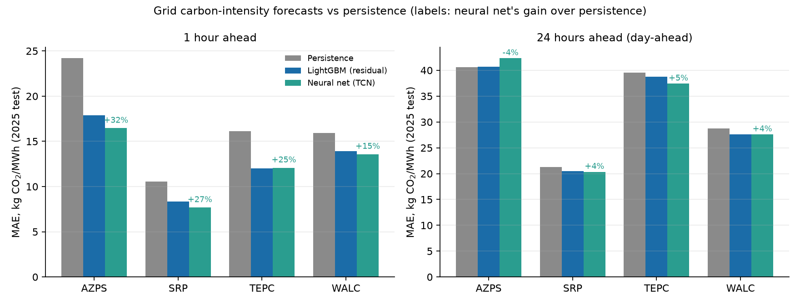
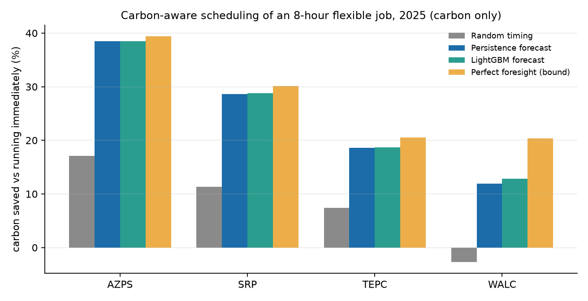
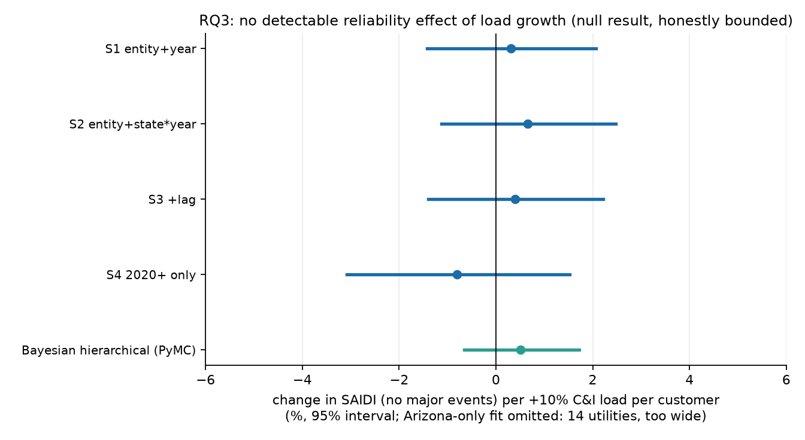
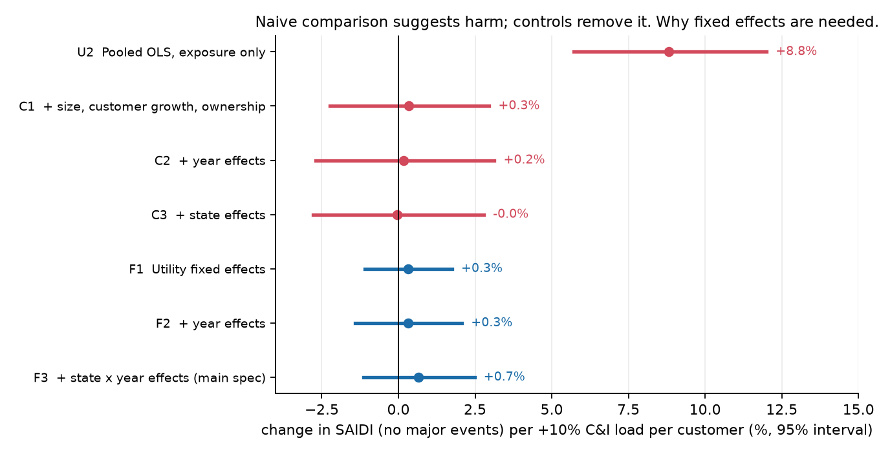
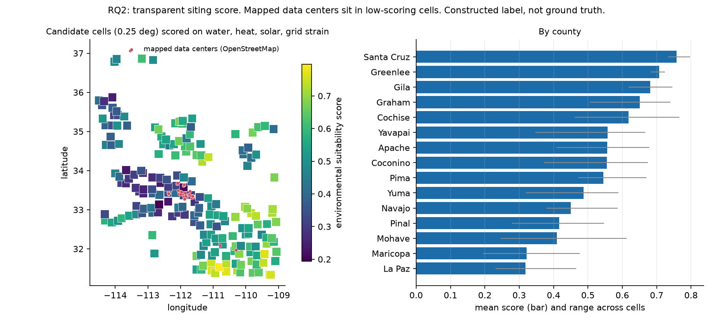
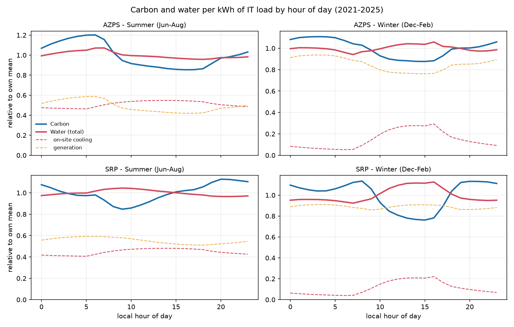
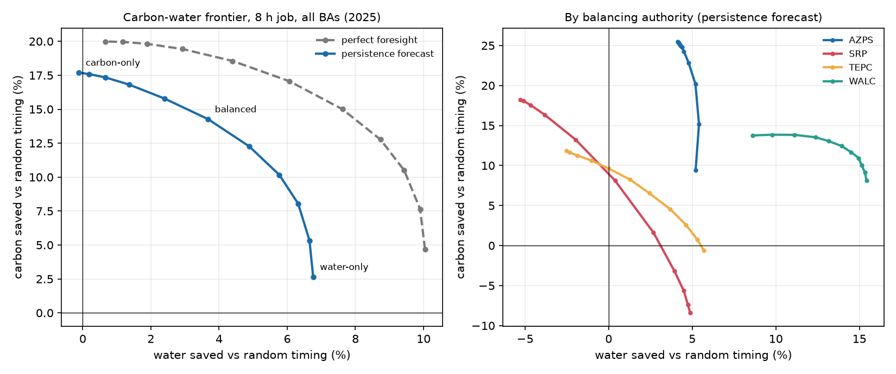

# Midpoint 1: Carbon, Water, and Reliability for Arizona's AI Data Centers

FSE 570 Data Science Capstone, Fall 2026. Status report with results to date, deviations from the
proposal, and known limitations.

## 1. Summary

Midpoint-1 requirements are met: the data pipeline is built across eight sources, all four technique
families (gradient boosting, panel regression, Bayesian hierarchical modelling, neural network) run on
real data, the forecaster beats its persistence baseline, and every research question has a working
baseline.

| Requirement | Status | Evidence |
|---|---|---|
| Data pipeline and data-sources rubric | Met | 8 sources, 5 data structures, 1.06M fuel-hour records (175,208 BA-hours), 12k-row utility panel, 46k wells ([data dictionary](data_dictionary.md)) |
| Forecaster beats persistence | Met | LightGBM: 13-26% lower MAE at 1 hour on all four BAs (neural net up to 15-32%); 2-4% at 24 hours on three of four, none on AZPS (Section 3) |
| Four technique families | Met | LightGBM, fixed-effects regression, PyMC hierarchical model, temporal CNN |
| Baseline for every arm | Met | RQ1 forecast + scheduler, RQ2 siting score, RQ3 regression + Bayesian model |

Three findings stand out, each stated with its limits:

1. **Timing matters, forecast sophistication barely does.** Scheduling an 8-hour job into cleaner hours
   saves about 24% carbon versus running immediately (17% versus random timing), and a perfect-foresight
   oracle adds only 3 points more. Persistence ("same hour yesterday") captures nearly all of the benefit.
2. **No detectable reliability harm from load growth, with explicit bounds.** The best public proxy shows
   +0.5% SAIDI per +10% commercial and industrial load (95% interval -0.7% to +1.7%). This is a null result,
   and the proxy is diluted: it cannot speak to data centers specifically.
3. **Mapped data centers sit in cells that score poorly on environmental criteria.** The 64 OpenStreetMap
   data-center features that fall inside the 192 candidate cells lie in 8 cells with a median rank of 160 of
   192 (other cells: 94); only 1 of the 64 is in the top tercile. This is a descriptive finding about a
   constructed score and incomplete map data, not a validated suitability model.

## 2. Data

Eight free public sources spanning hourly time series, an annual utility panel, plant records, spatial
points, per-well series, and gridded climate. Full coverage, cleaning rules, and known gaps are in the
[data dictionary](data_dictionary.md). The ones that shape the results:

- **EIA-930** (4 Arizona balancing authorities, 2021-2025) with eGRID emission factors gives hourly carbon
  intensity (174,740 BA-hours; 0.4% flagged and excluded).
- **EIA-861** (2013-2024) gives 11,845 usable utility-state-years after cleaning (15 in Arizona).
- **ADWR GWSI** gives groundwater depth at 45,985 sites, dense around Phoenix, Pinal and Tucson.

See [EDA.md](EDA.md) for distributions, trends and the unified tables.

**Important data finding.** The LBNL Queued Up dataset, which the proposal planned to use as a measure of
large-load growth, contains generation and storage requests only. It has no load or data-center requests.
RQ3's exposure variable therefore became commercial and industrial (C&I) sales per total customer (all
classes), from EIA-861.
LBNL is used only as a generator-queue strain feature in RQ2.

## 3. RQ1: When to run workloads

### Forecasting
Carbon intensity forecasts at 1 and 24 hours ahead, trained on 2021-2023, early-stopped on 2024, tested on
2025 (chronological split), compared on identical rows. The target is the residual over persistence, which
fixed an earlier failure where raw-target LightGBM lost to persistence at 24 hours. The residual target and
the demand features were chosen after seeing 2025 results, so they were re-tested with a different split
(train 2021-2022, early-stop 2023, test 2024): the raw-level model again loses to persistence at 24 hours
(TEPC -56%, AZPS -13%) while the residual model is within -3% to +6% of persistence, so the design choice
holds. LightGBM is treated as the primary model; the neural net was added afterwards as a secondary one.

| MAE (kg CO2/MWh) | Horizon | Persistence | LightGBM | Neural net | LightGBM gain | Neural net gain |
|---|---|---|---|---|---|---|
| AZPS | 1 h | 24.2 | 17.9 | 16.5 | +26.0% | +32.0% |
| SRP | 1 h | 10.5 | 8.4 | 7.7 | +20.6% | +27.1% |
| TEPC | 1 h | 16.1 | 12.0 | 12.1 | +25.4% | +25.0% |
| WALC | 1 h | 15.9 | 13.9 | 13.6 | +12.7% | +14.8% |
| AZPS | 24 h | 40.6 | 40.7 | 42.3 | **-0.2%** | **-4.2%** |
| SRP | 24 h | 21.3 | 20.4 | 20.3 | +3.9% | +4.5% |
| TEPC | 24 h | 39.5 | 38.7 | 37.4 | +2.1% | +5.4% |
| WALC | 24 h | 28.8 | 27.6 | 27.6 | +4.0% | +4.1% |

Reading: strong gains at 1 hour; at 24 hours the gain is small (2-4% for LightGBM) and AZPS shows none. Day-ahead demand
forecasts added about 1% on two BAs and hurt on AZPS. The neural net used one seed and a 96-hour window
(compute-limited, CPU only), so differences near 1 kg/MWh are within seed noise.

### Scheduling (Stage 2)
A flexible job needs k run-hours within a 24-hour window decided at local midnight. Savings are measured
on actual carbon intensity.

Pooled over BAs, 8-hour preemptible job, saving versus running immediately: random timing 8.2%,
persistence forecast 24.3%, LightGBM 24.5%, perfect foresight 27.5%. Paired bootstrap over days shows
LightGBM beating persistence by 0.1-0.25 points on SRP and 0.3-1.3 points on WALC, with no clear difference
on AZPS and TEPC. Contiguous (non-interruptible) jobs lose little relative to preemptible ones.

## 4. RQ3: Who pays? Reliability

**Design.** Utility-state-year panel, 2013-2024. Outcome: log SAIDI without major events. Exposure: change in
log C&I MWh per total customer. Utility fixed effects plus year or state-by-year effects (the latter absorbs
regional storm severity), standard errors clustered by utility.

| Specification | Effect of +10% C&I load per customer on SAIDI | 95% interval |
|---|---|---|
| Utility + year effects | +0.3% | -1.4% to +2.1% |
| Utility + state-by-year effects | +0.7% | -1.1% to +2.5% |
| + one-year lag | +0.4% | -1.4% to +2.2% |
| 2020 onward only | -0.8% | -3.1% to +1.5% |
| Bayesian hierarchical (PyMC) | +0.5% | -0.7% to +1.7% |

**Naive baseline and why fixed effects are needed.** On a single common sample (9,268 utility-years, 1,082
utilities), moving from an unconditional comparison to fixed effects changes the answer completely:

| Rung | Effect of +10% C&I load per customer on SAIDI | 95% interval |
|---|---|---|
| Surge utility-years (>10% growth) vs all others, no controls | **+40%** higher SAIDI | +26% to +55% |
| Pooled OLS, exposure only | **+8.8%** | +5.7% to +12.0% |
| + size, customer growth, ownership | +0.3% | -2.2% to +3.0% |
| + year effects | +0.2% | -2.7% to +3.1% |
| + state effects | 0.0% | -2.8% to +2.8% |
| Utility fixed effects | +0.3% | -1.1% to +1.8% |
| + year effects | +0.3% | -1.4% to +2.1% |
| + state-by-year effects (main specification) | +0.7% | -1.1% to +2.5% |

A naive comparison would conclude that load growth degrades reliability. The apparent effect disappears as
soon as utility size, customer growth and ownership are controlled, so it reflects *which* utilities grow
fast (smaller, different ownership), not what growth does to reliability.

**Reading it honestly**
- Every interval includes zero. The data rule out effects much larger than about +2.5% SAIDI per +10% load
  (the largest upper bound across specifications).
- The result survives restricting to a consistent reliability-reporting standard: 15% of utilities switch
  between IEEE and other definitions over time; dropping them gives +0.5% (-1.5% to +2.5%), IEEE rows
  only +0.1% (-1.9% to +2.2%).
- Heterogeneity across utilities is about zero in the Bayesian model (between-utility sd 0.008 per SD of
  growth), so the 14 Arizona utility estimates collapse toward the national value and are individually
  uninformative.
- The point estimate's sign changed (-0.09 to +0.04 in elasticity terms) when 0.5% of rows were removed
  as probable unit-reporting errors. The conclusion (null) is stable; the point estimate is not.
- Outcomes that include major-event days show *negative* associations (more load growth, less downtime),
  significant in most specifications. I believe this is reverse causation: storms cut power and depress sales in the same
  year. This is a hypothesis, not tested.
- **The proxy is diluted.** Most C&I growth is not data centers, so a data-center-specific effect could
  still be hidden.

**Bayesian layer, held-out 2024** (fit on 2013-2023, 849 utility-years):

| Nominal interval | 50% | 80% | 90% | 95% |
|---|---|---|---|---|
| Empirical coverage | 41.7% | 73.1% | 85.0% | 91.8% |

Slightly overconfident (about 5 points short at 90-95%). Predictive RMSE is 0.475 against 0.476 for
last year's value and 0.478 for the utility's own mean: it matches, but does not beat, naive baselines,
which is consistent with load growth explaining almost none of year-to-year SAIDI variation.
Sampler diagnostics: no divergences; the main parameter has ESS about 2,200, but the intercept scale
mixes slowly (R-hat 1.05, ESS about 70).

## 5. RQ2: Where to site?

192 candidate cells (0.25 degrees, about 25 km) scored on groundwater depth, groundwater trend, summer
wet-bulb temperature, solar, and county-level generator-queue strain.

**The label is constructed, not observed.** Suitability is a weighted mean of percentile ranks with
assumed weights (water depth 0.30, trend 0.10, wet-bulb 0.20, solar 0.15, queue strain 0.25). Logistic
regression and LightGBM trained on the top-tercile label reach AUC 0.96-0.99, but because the label is a
function of the same features this is a reconstruction check, **not validation**.

What is informative:
- **Rank stability:** across 2,000 random weight vectors the median rank correlation with the default
  ranking is 0.82 (5th percentile 0.23); only 2 cells stay in the top 10% in at least 80% of draws.
  Individual top picks are not robust to weights.
- **Mapped data centers (independent source):** 65 OpenStreetMap features tagged as data centers, 64 inside
  a candidate cell, concentrated in 8 cells (six in the Phoenix metro; Maricopa County). Those cells have a
  median rank of 160 of 192 against 94 for the others (Mann-Whitney p = 0.007); 75% of them are in the bottom
  third, and 1 of the 64 features is in the top tercile. The operator-tagged subset (31 features, 7 cells)
  gives the same picture (p = 0.03). OSM is incomplete and contains some mis-tagged IT businesses, and cells
  are about 25 km, so this is descriptive.
- **Drivers:** groundwater depth and queue strain dominate (SHAP 4.3 and 3.1); solar barely discriminates
  because it is uniformly high across Arizona.

Limits: the highest-scoring cells sit in remote southeastern counties, and the score has no transmission,
fiber, land, or workforce features, so they are probably not buildable. The queue-strain direction is an
assumption (a large queue could mean abundant new supply rather than strain). Queue MW is the sum of
capacities for hybrid projects and is county-level, so every cell in a county shares it. After an audit
fix, counties come from a point-in-polygon lookup (22 of 192 cells changed label), La Paz County was added
to the groundwater pull, and the default ranking changed little (rank correlation 0.99 with the earlier
version; 11 of the top 12 cells unchanged).

## 6. Preliminary: carbon versus water (Phase 2 preview)

Not a midpoint-1 requirement; included because it shapes the remaining work. Water per kWh of IT energy is
a scenario estimate: on-site cooling driven by hourly wet-bulb temperature, plus generation-side
consumption by fuel (see the [data dictionary](data_dictionary.md); factors are Macknick et al. 2012 medians).

- On-site cooling water is **anti-correlated** with carbon within a day (-0.5 to -0.6 on AZPS, SRP, TEPC):
  the cleanest solar hours are the hottest.
- Generation-side water **moves with** carbon (correlation about +0.99 on AZPS and TEPC) because coal and gas
  drive both, so the two effects largely offset on those two BAs.
- Pooled, a carbon-only schedule saves 17.7% carbon and about 0% water; a balanced one saves 14.3% carbon and
  3.7% water.
- **The conclusion is assumption-sensitive, and the sensitivity is itself the finding.** Scenarios scale
  nuclear's water by a scarcity weight (Palo Verde cools with reclaimed wastewater) and optionally count
  hydro reservoir evaporation (17 L/kWh). Water change under a carbon-only schedule:

| Scenario | Pooled | AZPS | SRP | TEPC | WALC |
|---|---|---|---|---|---|
| Base (nuclear as freshwater, hydro 0) | -0.1% | +4.1% | -5.3% | -2.5% | +8.6% |
| Nuclear x0.25 | +0.4% | +4.1% | -6.5% | -2.5% | +8.6% |
| Nuclear x0 (effluent free) | +0.6% | +4.1% | -7.3% | -2.5% | +8.6% |
| Hydro at paper minimum (5.4 L/kWh) | -5.0% | +4.1% | -4.9% | -2.5% | -11.7% |
| Hydro at paper median (17.0 L/kWh) | -10.5% | +4.1% | -4.0% | -2.5% | -17.8% |
| Hydro at paper maximum (68.1 L/kWh) | -17.0% | +4.1% | -0.3% | -2.5% | -20.9% |

  (Positive = saves water; negative = the carbon-optimal schedule uses more water.)
- **Reading it.** AZPS has no conflict in any scenario. TEPC and SRP have a modest, robust conflict
  (-2.5% and -4% to -7%) that **does not disappear** when Palo Verde's water is discounted: it is driven by
  on-site cooling, which peaks in the hot afternoon hours that solar makes cleanest. WALC shows a water saving only if
  hydro reservoir evaporation is excluded; at any value in the published range (the paper's minimum already
  gives a 11.7% penalty) the carbon-optimal schedule uses more water there. The earlier expectation that SRP's
  conflict was mainly a Palo Verde accounting artifact is **not supported**.
- Multi-site shifting results (44-54% savings) are artifacts of production-based accounting and the
  hydro assumption, and should not be used.

## 7. Deviations from the proposal

| Proposal | What happened | Why |
|---|---|---|
| LBNL queue measures large-load growth | Not available; C&I sales growth used instead | LBNL has generation requests only |
| Day-ahead forecasts beat persistence by a clear margin | 2-4% (LightGBM) and up to 5% (neural net) on three BAs, none on AZPS | Arizona's daily solar cycle is highly repeatable |
| Interconnection wait time as grid strain | County-level active generator-queue MW | No wait times or load queue available |
| Regulatory-exposure score from ACC filings | Not built | Scoped out as a supporting signal |
| ADWR Wells55 registry | GWSI well sites and a USGS-hosted subset | Scriptable access; Wells55 not pulled |
| PRISM weather control in RQ3 | State-by-year fixed effects | Absorb regional storm severity |
| Interactive dashboard | Static figures | Per the plan's own scope trim |

## 8. Known limitations
- Carbon intensity is production-based, not consumption-based; interchange is not modelled.
- Scheduling is simulated on historical data with unit-sized jobs, not real workloads.
- RQ3 is an association study at utility level and cannot attribute outages to data centers.
- The siting score has no ground truth and ignores infrastructure feasibility.
- Water factors are literature medians (Macknick et al. 2012) applied as scenarios; hydro rests on three
  studies spanning 1,425-18,000 gal/MWh, and Arizona's CSP plant is not separable from solar in the data.
- Timestamps: EIA documents hour-ending labels; the pipeline treats the label as a UTC hour. Solar profiles
  are consistent with that within about an hour, and shifting the weather series by plus or minus one hour
  changes the carbon-only water result by under 1 point.
- Outlier thresholds and winsorising for RQ3 were computed on the full sample, including the 2024 holdout year.
- Hub and cell evidence uses OpenStreetMap, which is incomplete; the neural net is one seed; the
  siting weights and queue-strain direction are assumptions.
- A self-audit of these and other assumptions is in [AUDIT.md](AUDIT.md).
- Regulatory claims were fact-checked by web search only; three literature citations in the proposal need
  correction and four are unverified ([regulatory_context_check.md](regulatory_context_check.md)).

## 9. Next steps
1. **Refine the water factors** with plant-level cooling types (EIA-860) and separate CSP from PV (the factors
   were checked against Macknick et al. 2012 and the scarcity scenarios are done).
2. **Marginal versus average emissions:** estimate marginal rates from the EIA-930 data and test whether the
   scheduling conclusions change.
3. **Revealed-preference siting:** replace the constructed label with actual data-center locations and add
   infrastructure features and spatial cross-validation.
4. **Stage 1 optimizer and frontier**, connecting the siting score and the reliability bound to the scheduler.
5. **Sharper RQ3 exposure** (a data-center-specific measure or an event study) or an explicit power analysis
   of what public data can and cannot detect.
6. Calibrated (conformal) intervals on the carbon forecasts to extend the uncertainty layer to RQ1.
