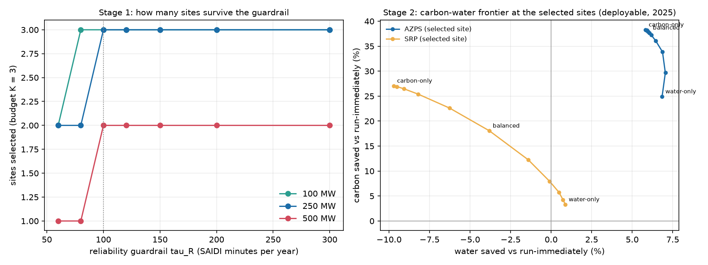
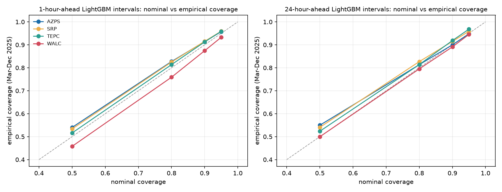

# Midpoint 2: Carbon, Water, and Reliability for Arizona's AI Data Centers

> **Update 2026-11-10:** after a plausibility cap on EIA-930 fuel values (`docs/MARGINAL.md`, "Second correction"), the marginal-accounting figures below were recomputed. The "40-55% carries over" statement is withdrawn; the forecast, conformal, consumption, water and framework numbers moved by at most about 3 points (forecast MAE gains) and are updated in the tables below (the final report, in progress, is not yet in the repo).

FSE 570 Data Science Capstone, Fall 2026. Status report for Checkpoint 2: the integrated decision framework, calibrated uncertainty,
the Arizona case study, and what changed relative to the proposal. It extends [MIDPOINT1_REPORT.md](MIDPOINT1_REPORT.md); results already
reported there are summarised, not repeated.

## 1. Summary

| Checkpoint 2 requirement (from the project context document) | Status | Evidence |
|---|---|---|
| Decision framework gives siting and scheduling recommendations with a working reliability-tolerance frontier | **Met as a scenario demonstration** on assumed inputs | `src/framework_endtoend.py`, `results/framework_*.csv`, [STAGE1.md](STAGE1.md), [STAGE2.md](STAGE2.md) |
| Arizona case study complete | **In progress**; drafted locally, to be added for the final presentation; policy facts rest on web search, not the eDocket | not yet in the repo |
| Results validated with calibrated uncertainty | **Partly met**: RQ1 conformal intervals, RQ3 Bayesian coverage; siting has no calibrated interval | Section 4 |
| Honest reporting whether or not RQ3 is significant | **Met**: RQ3 is a null with bounds | [MIDPOINT1_REPORT.md](MIDPOINT1_REPORT.md) section 4 |
| Static visualization suite (forecast error and calibration, SHAP, suitability and reliability map, sensitivity frontiers) | **Met**: all four now exist | Section 6 |
| Written report and presentation submission-ready by 1 Dec | **Not yet**: this is the status report; final report and deck remain | Section 9 |

Findings that stand out, each with its limit:

1. **The integrated framework runs end to end, and the result is mostly structural.** Utility size against project size decides which sites
   can host a 500 MW project before carbon or water enter; the reliability guardrail binds only between about 60 and 100 minutes of SAIDI.
   The selection is not stable to the siting weights (the top cell is chosen in 57% of random-weight draws, mapping "all").
2. **Scheduling gains are real as average-intensity savings; an unstable share of them carries over to a marginal estimate, and the two signals disagree.** An 8 h job saves about 24% against running
   at midnight using yesterday's same-hour intensity; savings hold under consumption-based accounting (12-26% on AZPS, SRP, TEPC). Scored on the marginal estimate they fall to 8% (2024) and 14% (2025) pooled, a share that moves between about a fifth and nearly all of it depending on year and BA, with sign flips by BA in single years, and a marginal-profile
   decision wins on its own accounting on AZPS, SRP and TEPC in both test years. **These marginal numbers were corrected after a data-quality problem was found in EIA-930 demand** (see [MARGINAL.md](MARGINAL.md)).
3. **Forecast uncertainty is usable.** Conformal 90% intervals cover 87-92% of 2025 targets and 95% intervals 93-97%, but coverage drops in single months
   (down to 70%) and LightGBM's intervals are only 2-8% narrower than persistence at 24 hours.
4. **Reliability: no detectable harm, bounded at +2.5% SAIDI per +10% C&I load** (+1.9% unclipped; the null survives removing the 1/99 clipping of the exposure). The design
   can detect 1.8-2.6% per +10% load nationally but only 8-25% in surge-year tests, and Arizona alone cannot be tested; the proxy cannot see data centers specifically
   ([RQ3_POWER.md](RQ3_POWER.md)). A data-center exposure built from mapped facilities per utility territory is too weak to test data-center load (first-stage F 2.8) and shows no sign of harm
   ([RQ3_DC_EXPOSURE.md](RQ3_DC_EXPOSURE.md)).
5. **Carbon and water interact weakly at the siting stage.** Adding operating carbon and water to the siting objective cannot change carbon (one APS-served and
   one SRP-served site either way) and moves water by 3-13%.

## 2. What was done since Midpoint 1

| Piece | Code | Document |
|---|---|---|
| Stage 2 siting coupling (operating carbon and water in the site objective) | `stage2_coupling.py` | [STAGE2.md](STAGE2.md) |
| Marginal vs average emissions, two test years, weather and interchange controls (corrected for a demand data-quality problem) | `marginal_emissions.py`, `mef_robustness.py` | [MARGINAL.md](MARGINAL.md) |
| Interchange and consumption-based carbon by flow tracing | `pull_interchange.py`, `pull_neighbor_fuel.py`, `interchange_analysis.py`, `consumption_carbon.py` | [CONSUMPTION.md](CONSUMPTION.md) |
| Conformal forecast intervals | `forecast_conformal.py` | Section 4 |
| End-to-end framework (Stage 1 to Stage 2) | `framework_endtoend.py` | Section 3 |
| Arizona case study numbers | `case_study_numbers.py` | case study write-up in progress (not yet in the repo) |
| Map and SHAP figures | `make_checkpoint2_figures.py` | Section 6 |
| RQ3 power analysis and a check on the clipped exposure | `rq3_power.py` | [RQ3_POWER.md](RQ3_POWER.md) |
| RQ3 data-center-specific exposure (OSM x utility territories) | `rq3_datacenter_exposure.py` | [RQ3_DC_EXPOSURE.md](RQ3_DC_EXPOSURE.md) |
| Measured generation-side water (EIA-860/923 cooling data, CSP vs PV) | `build_water_factors.py`, `water_measured.py` | [WATER_MEASURED.md](WATER_MEASURED.md) |
| Multi-BA test of marginal-estimate stability (pre-registered; inconclusive) | `pull_ba_panel.py`, `eia930_qc.py`, `ba_stability_scan.py` | [MEF_SCAN.md](MEF_SCAN.md) |
| Interconnection screen for Stage 1 (voltage and proximity, node cap) | `stage1_interconnection.py` | [STAGE1_INTERCONNECTION.md](STAGE1_INTERCONNECTION.md) |
| Literature check (first pass, search excerpts only) | n/a | in progress (not yet in the repo) |

## 3. The integrated framework

**Stage 1** chooses sites to maximise environmental suitability subject to a per-utility cap derived from the reliability guardrail
(projected SAIDI at or below tau_R, and added load at most 25% of the utility's C&I sales). **Stage 2** schedules a flexible job at the
balancing authority of each chosen site. Weights between carbon and water (alpha) are a named assumption and are swept, not fitted.

**Reliability-tolerance frontier** (budget K = 3, mapping "all"; `results/framework_stage1_sweep.csv`):

| Project size | tau_R 60-80 min | tau_R 100 min and above |
|---|---|---|
| 100 MW | 2-3 sites (suitability 0.74 at 60; 1.53 at 80) | 3 sites, suitability 2.22, mean rank 11 |
| 250 MW | 2 sites, suitability 0.74, mean rank 148 | 3 sites, suitability 1.82, mean rank 55 |
| 500 MW | 1 site (SRP), suitability 0.40, rank 133 | 2 sites (Cochise/APS, Maricopa/SRP), suitability 1.15, mean rank 70 |

**Stage 2 at the default scenario** (500 MW, tau_R = 100 min; policies are deployable: decided on yesterday's same-hour values, 2025, 8 h preemptible job,
% saved against running immediately; water is a scenario estimate; `results/framework_scenario_default.csv`):

| Policy | AZPS (Cochise site) carbon / water | SRP (Maricopa site) carbon / water |
|---|---|---|
| Naive (run immediately) | 0 / 0 | 0 / 0 |
| Carbon-only (alpha = 1) | 38.2 / 5.7 | 27.1 / -9.7 |
| Balanced (alpha = 0.5) | 37.6 / 6.0 | 18.0 / -3.8 |
| Water-only (alpha = 0) | 24.8 / 6.8 | 3.3 / 0.9 |
| Oracle, balanced (not deployable) | 38.8 / 7.1 | 20.2 / -1.8 |

**Reading it honestly.**
- This demonstrates the framework on assumed inputs (500 MW, load factor 0.8, PUE 1.2, the on-site cooling curve, the 25% support limit); it is not a siting
  recommendation. The cells are 25 km squares with no transmission, fiber or land features, and several utility assignments are approximate.
- The 500 MW selection is two cells, one of which ranks 133 of 192 on suitability.
- The conflict between carbon and water exists at SRP (and TEPC) and not at AZPS; balanced weighting gives up part of the carbon saving to avoid it.
- At 500 MW the utility's size, not its reliability record, is the binding constraint; at equal site count (K = 2) the guardrail costs 26% of total suitability
  (1.15 vs 1.56 unconstrained, [STAGE1.md](STAGE1.md)).
- Production-based accounting: SRP's carbon looks low partly because Palo Verde is reported there. Consumption-based accounting changes the carbon figure
  of the Stage 1 set by -15% but leaves the selection unchanged ([STAGE2.md](STAGE2.md)).

## 4. Calibrated uncertainty

**RQ1 (new).** Online split-conformal intervals for the LightGBM `resid_lags` forecast (the primary model; its MAE gains match section 3 of the Midpoint 1 report),
calibrated per local hour of day on residuals available 24 h before each target day; scored on Mar-Dec 2025 targets (`src/forecast_conformal.py`,
`results/forecast_conformal.csv`). The calibration pool is 2025 itself because the 2021-2024 predictions were not saved.

| Empirical coverage, LightGBM | 80% nominal | 90% nominal | 95% nominal |
|---|---|---|---|
| 1 h, AZPS / SRP / TEPC / WALC | 0.83 / 0.82 / 0.81 / 0.76 | 0.92 / 0.91 / 0.91 / 0.87 | 0.96 / 0.96 / 0.96 / 0.93 |
| 24 h, AZPS / SRP / TEPC / WALC | 0.81 / 0.82 / 0.81 / 0.79 | 0.90 / 0.91 / 0.92 / 0.89 | 0.95 / 0.96 / 0.97 / 0.94 |

- Marginal coverage is within about 3 points of nominal (80-95% levels) on AZPS, SRP and TEPC; WALC under-covers by up to 4 points (0.76 at 80%, 1 h).
- **Conditional coverage is weaker**: the worst single month for 90% intervals at the 24 h horizon is 83% (AZPS, April), 70% (SRP, November), 83% (TEPC, December), 76%
  (WALC, November); SRP's 24 h intervals cover 98% in summer and 87% otherwise (`results/forecast_conformal_by_month.csv`).
- LightGBM's 90% intervals are 14-27% narrower than persistence's at 1 h and only 2-8% narrower at 24 h, consistent with the small point-forecast gains.
- Conformal guarantees assume exchangeable residuals; time series are not, so empirical coverage is what is claimed.

**RQ3.** The hierarchical model's held-out 2024 coverage is 91.8% at a 95% nominal interval (slightly overconfident; 85.0% at 90%), and its predictive
error matches but does not beat naive baselines ([MIDPOINT1_REPORT.md](MIDPOINT1_REPORT.md) section 4).

**RQ2 / siting.** No calibrated interval exists: the label is constructed, rank stability under random weights is the uncertainty measure (median rank
correlation 0.82; the top cell is selected in 57% of weight draws under mapping "all" and 21% under "large").

**Scheduling savings** carry paired-bootstrap intervals across days (Midpoint 1); they are not recalibrated here.

## 5. Accounting: average, consumption and marginal emissions
Summary of [CONSUMPTION.md](CONSUMPTION.md) and [MARGINAL.md](MARGINAL.md):
- Consumption-based intensity by flow tracing changes the ranking (production: WALC < SRP << AZPS ≈ TEPC; consumption: SRP < WALC < AZPS < TEPC) and the AZPS
  figure by -28% (508 to 364 kg/MWh); scheduling savings stay at 12-26% on AZPS, SRP and TEPC.
- **Correction.** An earlier version of this section was computed on demand data with glitches (e.g. SRP 70,313 MWh against a median of 3,407; WALC down to -50,457) and several of its conclusions were wrong. After a plausibility rule
  (demand not positive or above 5 times the BA median is dropped), see [MARGINAL.md](MARGINAL.md):
- Marginal rates from in-BA EIA-930 data are unstable at hourly resolution (train-test correlation 0.07-0.26). At 6 h bins the profile shape is stable on AZPS, SRP and TEPC in both test years (correlations 0.60-0.76) and on WALC in 2024 only (0.65, then -0.60 in 2025);
  the level moves by a third to three quarters. Weather and interchange controls do not reliably help.
- Scheduling: yesterday's average intensity saves 14-18% by average accounting and 8-14% pooled by the marginal estimate; a marginal-profile decision saves 5% by average accounting and 27-43% by the marginal one. Each signal wins on its own accounting,
  so the "carbon saved" figure depends on the accounting. Savings percentages against the marginal estimate can be ill-conditioned (AZPS 2025), so read signs, not sizes.
- Consequence: report RQ1 savings as average-intensity savings and state that the share carrying over to a marginal estimate is unstable (about 20% to 95% by year and BA group).

## 6. Visualization suite
| Required plot | File |
|---|---|
| Forecast error vs baselines | `results/figures/m1_forecast_vs_baselines.png` |
| Forecast calibration and example intervals | `results/figures/forecast_calibration.png`, `forecast_intervals_example.png` |
| SHAP summary (mean absolute SHAP, bars) | `results/figures/rq2_shap_summary.png` |
| Map of suitability and reliability risk | `results/figures/map_suitability_reliability.png` |
| Sensitivity frontiers | `results/figures/stage1_frontier.png`, `frontier_carbon_water.png`, `framework_endtoend.png` |
The SHAP plot is a bar summary of the saved importances, not a beeswarm; the label is a function of the same features, so it recovers the assumed weights.

## 7. Arizona case study
The Arizona case study (in progress; the write-up is not yet in the repo) maps the framework onto the live debate. Main points: scale and interconnection limits dominate siting; an environmental
score alone is a poor screen because real data centers follow population and substations; RQ3 bounds reliability harm but says nothing about rates or
cost allocation, the ACC docket's focus; scheduling moves water by at most about 7%, so a per-gallon fee would act mainly on cooling design. A hypothetical
$0.01 a gallon on one 500 MW project's modelled on-site water is $3.6-9.4 million a year. Policy facts are from web search and need eDocket confirmation.

## 8. Deviations from the proposal (updated)
| Proposal | What happened | Why |
|---|---|---|
| LBNL queue measures large-load growth | C&I sales growth per customer (EIA-861) | LBNL has generation and storage requests only |
| NREL NSRDB and NOAA/PRISM weather | NASA POWER (192 cell climatologies and 3 hourly series); state-by-year fixed effects replace the PRISM control | NSRDB and PRISM were not pulled; NASA POWER is scriptable but coarser than 0.25 degrees ([data_dictionary.md](data_dictionary.md)) |
| Forecast day-ahead carbon intensity **and solar availability** | Carbon intensity only; no separate solar-availability forecast | Not built; solar enters only through the carbon-intensity target and the cell irradiance in the siting score |
| Day-ahead forecasts beat persistence clearly | 2-5% (LightGBM) on three BAs, none on AZPS | Arizona's solar cycle is highly repeatable |
| One shared Bayesian layer | PyMC hierarchical model for RQ3 only | Not extended to the forecasting or siting arms |
| Interconnection wait time as grid strain | County-level active generator-queue MW | No wait times or load queue public |
| Regulatory-exposure score from ACC filings | Not built; case study is qualitative | Scoped out |
| ADWR Wells55 | GWSI well sites and USGS-hosted series | Scriptable access |
| 48-hour training-job example | 24 h windows, 4, 8 or 12 run-hours | Test design; savings fall for longer jobs (AZPS 8 h 38.5%, 12 h 24.7% vs immediate, `schedule_savings.csv`) |
| Four-person team with assigned roles | Solo; roles and timeline not used | Team change |
| Interactive dashboard | Static figures | Per the plan's own scope trim |
| Alpha and beta set from social cost of carbon and a water-scarcity premium | Alpha swept 0 to 1 and plotted; no price calibration | No agreed water price; the frontier is the output |
Added beyond the proposal: revealed-preference siting from real data-center locations, the Stage 1 optimizer on utility territories, interchange, marginal and
consumption-based carbon, the siting coupling, conformal intervals, and a literature check.

## 9. Known limitations
- Interconnection is a voltage-and-proximity screen on OSM substations with assumed thresholds, not a capacity model: the default top cell (Cochise) is 93 km from a 230 kV substation, and the screen costs 6-13% of suitability at moderate thresholds ([STAGE1_INTERCONNECTION.md](STAGE1_INTERCONNECTION.md)).
- All framework outputs are scenarios on assumed inputs; Stage 1 selection depends on the siting weights and utility-territory approximations.
- Carbon is production-based by default; consumption-based and marginal versions are covered above, with their own limits.
- The hourly weather series cover three stations; cell-level on-site water uses an assumed wet-bulb shift.
- RQ3 is an association study with a diluted proxy; it cannot attribute outages to data centers.
- Generation-side water: literature medians remain the base case; measured EIA-860/923 factors are a sensitivity ([WATER_MEASURED.md](WATER_MEASURED.md)). They keep the SRP, TEPC and WALC conflicts but
  remove the Midpoint 1 claim that AZPS has none (it depends on how Solana's water is spread over the day: -1.6% to +4.6%). Plant-to-BA generation does not match EIA-930 for several BAs and fuels.
- The neural network is one seed; conformal intervals for it were not built.
- Outlier thresholds for RQ3 used all years including the 2024 holdout.
- Policy facts were checked by web search only; three proposal citations need correction and four are unverified ([regulatory_context_check.md](regulatory_context_check.md)).
- The literature check is a first pass from search excerpts; no piece of the project is clearly novel in method (literature write-up in progress; not yet in the repo).

## 10. Next steps toward 1 Dec
1. Final report and presentation: assemble Midpoint 1 and 2 results, with the nulls and the withdrawn claims stated plainly; correct the proposal's citations
   and the Colorado River figure.
2. Optional strengthening, in order of payoff: a data-center-specific reliability exposure or an explicit power analysis for RQ3; EIA-860 cooling types and a CSP/PV
   split in generation-side water; interconnection-capacity constraints in Stage 1.
3. Finish the literature check (siting-optimization, ERCOT/Virginia event studies, the ACC docket text) and read the closest papers in full.
4. A brief for the ACC docket from the case study, once its policy facts are confirmed.
